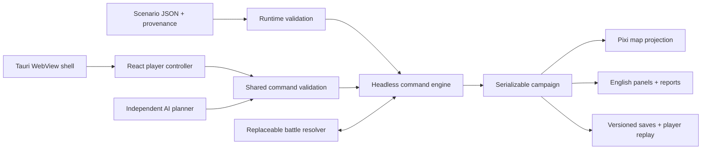

# Architecture

## Boundaries

The core is ordinary strict TypeScript with no imports from React, Pixi, Babylon, Tauri, browser APIs, Node I/O, or wall-clock functions. It runs headlessly in Vitest/Node. JSON data is validated by Zod before use. Presentation observes campaign state; rendering objects are never serialized.

## Modules and state flow

- `schema.ts`: portable runtime schemas and inferred static types for world regions, geometry, domains/regents, bloodlines, holdings, military, treaties, domain commands, events, spells, economy reports, scenarios, and saves.
- `validation.ts`: shared preconditions, cost calculation, external scenario validation, relational integrity. Invalid commands return a typed error and the unchanged input object. No PRNG draws or resource consumption occur on rejection.
- `engine.ts`: immutable command boundary; it clones once after validation. Accepted commands mutate only that private working copy, append coded journal entries and history, and return a new campaign. No command can mutate an input campaign.
- `rules.ts`: data-driven CLASSIC/ENHANCED configurations. Numerical balance parameters and seasonal war behavior live here. Profiles share the M0 simplified systems; CLASSIC is explicitly incomplete.
- `selectors.ts`: pure projections for relation, unit strength, domain power, economic forecasts, magical potential, and diplomatic willingness. Views use these rather than reimplementing rule decisions.
- `ai.ts`: ordered candidate planner. It assesses threatened borders, relative strength, treasury and upkeep, development potential, and relations. It returns a command and reason, never changes state. Every selected command passes the same validation as player commands.
- `combat.ts`: synchronous `BattleResolver` contract and deterministic auto-resolver. Future tactical adapters return authoritative outcomes rather than duplicating campaign state. A future async scene will need a serialized pending-battle phase before committing results.
- `persistence.ts`: version-1 envelope, schema and reference checks, scenario ID/revision compatibility, finite values, duplicate IDs, holding capacities, ID sequence.
- `strategic-map.ts`: WebGL Pixi Application using v8 async init, on-demand render, pointer hit testing, hover/selection, wheel zoom, drag pan, overlays, and resize cleanup. Procedural relief is display-only deterministic noise, independent of campaign RNG.
- `apps/game/src/storage.ts`: localStorage and JSON download adapters. Storage exceptions are shown to the user. Manual and automatic slots are separate.

The player selects a regent and seed. `createCampaign` clones immutable scenario starting conditions into mutable campaign state. React dispatches typed commands to `applyCommand`. State changes trigger selectors, panels, and renderer projection updates, plus optional autosave. The core is the sole authority for resource changes and outcomes.

## Turn resolution

M0 orders execute immediately while the player has up to three domain actions. Free tax-policy changes and event choices do not consume an action. EndTurn does the following in stable order:

1. Forfeit unused player actions; an unanswered player petition defaults to decline.
2. Visit active AI realms sorted by ID. Replan after each order, validate it, and execute within the same three-action budget. Record each decision/reason. Free event decisions are processed as part of this loop.
3. Settle all active realms sorted by ID. Tax provinces sorted by ID using serialized Mulberry32 state and the original PC ranges. Collect guild/temple income and any externally defined routes. Pay province/fort and unit upkeep. Handle shortfalls with deterministic disbanding and loyalty consequences. Add class-dependent, bloodline-limited regency.
4. Expire wars if the configured profile requires it. Increment the quarterly turn. Expire magical effects, reset army movement and action budgets.
5. Check defeat, territorial victory, and end-of-campaign province-level scores. Tied scores use realm ID as an explicit deterministic tie-break.
6. If ongoing, generate one weighted seeded event per active realm, with a stable province-selection order; record the new council.

This is a documented modernization. The original reports/management/actions sequence collects resources before actions; M0 settles accounts at the transition after actions. No claim of exact original AI initiative or interleaved monthly action resolution is made.

## Determinism and replay

No `Math.random`, `Date`, asynchronous operations, or environment-dependent input exists in the engine. RNG state and initial seed are uint32 values in the campaign. Integer arithmetic governs money, regency, and casualties. IDs are validated as lowercase ASCII letters/digits/underscore/hyphen. Tie-breaking uses explicit code-unit comparisons, independent of system locale.

The history stores accepted player and AI commands. Replay re-applies **player entries only**, regenerating AI decisions on EndTurn. This avoids double-applying AI commands. Journals and history remain in saves; journals/history can grow during extended sandbox use, whereas economic reports retain the last 60 realm entries. Scenario revisions and ruleset identity must remain fixed for a replay; rules changes require versioned migrations or new regression fixtures.

## Offline platforms and future work

The frontend is a Vite static bundle. Tauri displays that same bundle with a restrictive CSP and no native privileged plugins. Local saves need no IPC. The Tauri launcher establishes the correct frontend working directory and the configuration references only the built frontend. Cargo/Rust are unavailable here, so the native toolchain and WebView behavior remain untested.

Babylon is not installed or instantiated. Battle/adventure request/result interfaces reserve boundaries for future 3D layers without a second authoritative campaign. Networking, persistence servers, distributed event sourcing, and multiplayer authorization are not implemented. The deterministic boundary is suitable for a later server, but actor authentication and pending-phase protocols would have to be added then.
